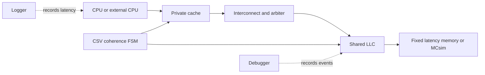

# Architecture

Octopus models a multicore memory hierarchy as clocked, configurable components
connected by bounded interfaces. A memory request is a first-class message that
moves through the hierarchy while the `ClockManager` advances each component.

## Core abstractions

| Abstraction | Responsibility |
| --- | --- |
| `ClockedObj` | Advances a component one simulation tick |
| `Configurable` | Loads hierarchical CSV parameters and CLI overrides |
| `Message` | Carries request identity, address, source, owner, and data |
| `CommunicationInterface` | Buffers messages between components |
| `CacheController` | Queues requests and executes protocol actions |
| `CacheDataHandler` | Models arrays, MSHRs, write-back buffers, and replacement |
| `InterconnectTopology` | Describes connectivity and message-holding interfaces |
| `InterconnectController` | Moves traffic and invokes an arbiter |
| `MainMemoryController` | Models fixed-latency memory; MCsim provides an external path |
| `FSMReader` | Reads CSV protocol transitions at startup |

## Request lifecycle

The Logger divides a request into queueing, bus, cache, memory, and response
stages. Components communicate through interfaces rather than calling each other
synchronously, which keeps back-pressure and timing visible.

For the implementation-level walkthrough, see the source repository's
[Architecture.md](https://github.com/FanosResearch/OctopusSimulator/blob/stable/docs/Architecture.md).