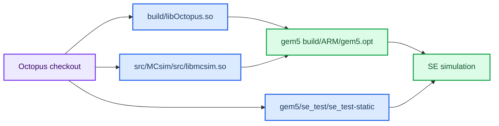

# gem5 integration

Octopus can run standalone with trace replay or as the cache and memory
hierarchy behind a real CPU model in gem5. The hierarchy configuration remains
the same; only the request source changes.


## Supported run modes

| Mode | CPU and operating system | Best use |
| --- | --- | --- |
| Trace replay | Octopus trace-driven CPU | Fast deterministic baseline |
| Trace replay over MCsim | Octopus trace-driven CPU with the MCsim memory model | Memory-system timing studies |
| gem5 SE | ARM CPU model and a statically linked workload | Fast bridge and protocol checks |
| gem5 full system | ARM CPU model booting Linux | Reference configuration only; no image is provided |

The SE mode does not need a kernel, disk image, or checkpoint and is the
provided end-to-end gem5 demonstration. A full-system configuration is included
as a reference, but this repository does not provide a kernel, disk image,
bootloader, or checkpoint.

## Build the complete stack

The build order matters: the Octopus and MCsim shared libraries must exist
before gem5 is built with this repository as an `EXTRAS` module. The SE
workload is a separate AArch64 executable and must also be built before the
first run.



### Install host prerequisites

On Ubuntu, install the native compiler, CMake, Make, Git, SCons, and the
AArch64 cross compiler used by `gem5/se_test/Makefile`. gem5 has additional
build dependencies; install the packages listed by the
[gem5 build documentation](https://www.gem5.org/documentation/general_docs/building)
for the gem5 version being used.

```bash
sudo apt-get update
sudo apt-get install -y build-essential cmake git scons \
    g++-aarch64-linux-gnu
```

The commands below assume the repository root is `$OCTOPUS_ROOT`:

```bash
export OCTOPUS_ROOT=/path/to/OctopusSimulator
cd "$OCTOPUS_ROOT"
```

### Build Octopus and MCsim libraries

Build both shared libraries before invoking SCons. Octopus's CMake build
produces `build/libOctopus.so`; MCsim's Makefile produces
`src/MCsim/src/libmcsim.so`.

```bash
make -C "$OCTOPUS_ROOT/src/MCsim/src" libmcsim.so -j"$(nproc)"
cmake -S "$OCTOPUS_ROOT" -B "$OCTOPUS_ROOT/build" \
    -DCMAKE_BUILD_TYPE=Release
cmake --build "$OCTOPUS_ROOT/build" -j"$(nproc)"

export LD_LIBRARY_PATH="$OCTOPUS_ROOT/build:$OCTOPUS_ROOT/src/MCsim/src${LD_LIBRARY_PATH:+:$LD_LIBRARY_PATH}"
```

Check the expected artifacts before continuing:

```bash
test -f "$OCTOPUS_ROOT/build/libOctopus.so"
test -f "$OCTOPUS_ROOT/src/MCsim/src/libmcsim.so"
```

### Clone and build gem5 with `EXTRAS`

Do not copy the Octopus bridge files into the gem5 source tree. Clone the
matching gem5 release separately, apply the repository's patch, and pass the
Octopus checkout itself to SCons as `EXTRAS`:

```bash
export GEM5_ROOT=/path/to/gem5
git clone --depth 1 --branch v25.1.0.1 \
    https://github.com/gem5/gem5.git "$GEM5_ROOT"
cd "$GEM5_ROOT"
git apply "$OCTOPUS_ROOT/gem5/patches/gem5-v25.1.0.1-arm-globalClearExclusive-no-squash.patch"
scons EXTRAS="$OCTOPUS_ROOT" build/ARM/gem5.opt -j"$(nproc)"
```

The repository helper performs the same checkout, patch, and build steps:

```bash
cd "$OCTOPUS_ROOT"
bash gem5/get_gem5.sh "$GEM5_ROOT"
```

The helper refuses to build if `build/libOctopus.so` is missing. Building
gem5 with `EXTRAS="$OCTOPUS_ROOT"` is what makes the `Octopus` SimObject and
`gem5/configs/octopus_cache_hierarchy.py` available to gem5.

### Build the SE workload

Build the checked-in AArch64 test workload using the same gem5 `m5ops`
assembly that provides its ROI markers:

```bash
make -C "$OCTOPUS_ROOT/gem5/se_test" clean all
file "$OCTOPUS_ROOT/gem5/se_test/se_test-static"
```

The default `se_arm.py` workload is the statically linked
`gem5/se_test/se_test-static`, so it needs no kernel, disk image, or sysroot.
For the dynamic variant, build `se_test-dynamic` and pass
`--workload-type dynamic --sysroot /usr/aarch64-linux-gnu`.

After this step, use `$GEM5_ROOT/build/ARM/gem5.opt` in place of `gem5` in
the commands below. A change in `gem5/octopus.cc`, `gem5/octopus.hh`, or
`gem5/Octopus.py` requires rebuilding gem5. A change to Octopus C++ sources
requires rebuilding `libOctopus.so`; a change to MCsim sources requires
rebuilding `libmcsim.so`. Re-export `LD_LIBRARY_PATH` in every new shell.

## Configure the cache interface

The cache interface is implemented by
`gem5/configs/octopus_cache_hierarchy.py`, not by replacing gem5's CPU or
memory objects. `OctopusCacheHierarchy` is a gem5
`AbstractClassicCacheHierarchy`: it exposes normal gem5 CPU- and memory-side
ports, while each `Octopus` bridge models one Octopus cache endpoint.

The wiring performed by `incorporate_cache()` is:

| Component | Connection | Purpose |
| --- | --- | --- |
| Each CPU instruction port | `cpu.connect_icache(bridge.cpu_side)` | Sends instruction requests to an Octopus L1 endpoint |
| Each CPU data port | `cpu.connect_dcache(bridge.cpu_side)` | Sends loads, stores, and atomics to an Octopus L1 endpoint |
| Each bridge memory side | `bridge.mem_side = membus.cpu_side_ports` | Sends timed requests and coherence traffic to the system crossbar |
| Each gem5 memory controller | `controller.port = membus.mem_side_ports` | Provides the final gem5 byte storage |
| CPU walker ports and x86 interrupts | crossbar ports | Keeps gem5 page-table walks and interrupt paths connected |

For `n` cores, the reference class creates `2 * n` bridges:
instruction-cache IDs `0..n-1` and data-cache IDs `n..2*n-1`. Both bridges
for core `i` use `log_core=i`, so instruction and data requests are combined
in that core's Octopus logger. The CSV preset must declare the matching
number of Octopus caches and `cpu_type=ExternalCPU`; the default
`MultiCoreSystem_gem5` preset is sized for four cores.

Only the first bridge initializes the shared Octopus system. Therefore every
bridge receives the same `config_name`, output path, and
`--octopus-param` overrides. The overrides use Octopus's
`name(type)=value` syntax and are applied on top of the CSV preset:

```bash
"$GEM5_ROOT/build/ARM/gem5.opt" -re -d se_test_rr \
    "$OCTOPUS_ROOT/gem5/configs/se_arm.py" \
    --octopus-config MultiCoreSystem_gem5 \
    --octopus-param 'bus[0].interconnect_controller.arbiter_type(s)=RRArbiter'
```

This design separates responsibilities: gem5 owns CPU execution, packets,
and the backing bytes; Octopus owns cache timing, arbitration, coherence,
and the MCsim DRAM timing model. To use a different cache hierarchy, keep
the `AbstractClassicCacheHierarchy` port contract, create the appropriate
bridge objects, connect CPU and memory ports in `incorporate_cache()`, and
ensure the CSV cache IDs match the bridge IDs.

## Run the SE smoke test

The checked-in `gem5/se_test/se_test-static` workload exercises private
streaming, a shared atomic counter, and a producer/consumer phase. Run the
Octopus hierarchy:

```bash
"$GEM5_ROOT/build/ARM/gem5.opt" -re -d se_test_o3_oct \
    "$OCTOPUS_ROOT/gem5/configs/se_arm.py"
```

For a baseline using gem5's classic caches:

```bash
"$GEM5_ROOT/build/ARM/gem5.opt" -re -d se_test_o3_classic \
    "$OCTOPUS_ROOT/gem5/configs/se_arm.py" --classic
```

The configuration accepts `--octopus-config`, repeated `--octopus-param`,
`--cache-ports`, `--max-ticks`, `--binary`, `--num-cores`, and
`--cpu-type {o3,timing}`. Pass workload arguments after `--`:

```bash
"$GEM5_ROOT/build/ARM/gem5.opt" -re -d se_test_short \
    "$OCTOPUS_ROOT/gem5/configs/se_arm.py" -- 2 64 100
```

The final line should be `RESULT: PASS`. For a dynamic AArch64 binary, use
`--workload-type dynamic` and provide the cross-toolchain sysroot with
`--sysroot`.

## Full-system reference

The repository includes
[`gem5/configs/fs_arm.py`](/home/laiy24/oct/OctopusSimulator/gem5/configs/fs_arm.py)
as a reference for connecting a booted ARM Linux system to the same
`OctopusCacheHierarchy` used by the SE example. It documents the expected
processor, board, memory, resource, and ROI-marker setup.

No full-system image bundle or image-download helper is provided. To run this
configuration, supply your own gem5-compatible ARM kernel, bootloader, disk
image, checkpoints, and resource directory, then follow the argument and
resource requirements defined in `fs_arm.py`. The SE example above is the
supported from-scratch demonstration.

## Inspect and compare results

Each `-d` directory is a self-contained result directory. Inspect:

| File or output | What it contains |
| --- | --- |
| `stats.txt` | ROI and final gem5 statistics, including `simTicks`, per-core cycles, IPC, and load-to-use latency |
| `config.ini` | Resolved gem5 and bridge configuration |
| terminal output | Octopus snoop, hold-back, and port-refusal counters |
| Octopus logger output | Request-stage timing and optional coherence traffic |

`stats.txt` contains two dumps when ROI markers are used: the measured ROI at
`m5_work_end` and the final dump at exit. Compare the ROI sections, not only the
final totals. A useful first comparison is `simTicks`, each core's
`numCycles` and `ipc`, and `lsq0.loadToUse` between the Octopus and `--classic`
runs.

To inspect Octopus request timing, convert a logger directory with Octoviz:

```bash
./octoviz.sh convert se_test_o3_oct
./octoviz.sh serve se_test_o3_oct
```

Open the local URL printed by `serve`. The viewer provides request pipelines,
shared-resource lanes, an inspector, and a coherence transition table. Include
the simulator trace option when launching a run if invalidations, write-backs,
fills, and other non-request traffic must be visible.

## Troubleshooting

| Symptom | Check |
| --- | --- |
| `libOctopus.so` is missing or stale | Rebuild Octopus before launching gem5 |
| gem5 bridge symbols do not compile | Rebuild gem5 after changing `gem5/` or included Octopus headers |
| Full-system run cannot start | `fs_arm.py` is a reference only; provide your own compatible kernel, bootloader, disk image, checkpoints, and resources |
| `RESULT: FAIL` in SE mode | Check workload arguments, binary architecture, and the selected Octopus configuration |
| Different ROI numbers | Compare `config.ini`, gem5 version, CPU type, core count, and Octopus CSV overrides |

For the design rationale and the full integration-mode discussion, see the
[Architecture deep dive](tutorial/Architecture.md) and the
[reference manual](reference-manual.md).
