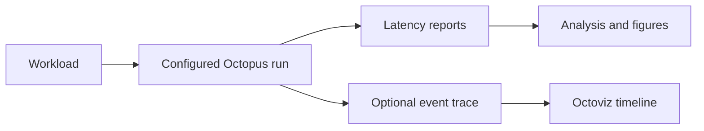

# Octopus Simulator

Octopus is a cycle-accurate cache system simulator for multicore memory-system
research. It models cache controllers, coherence protocols, configurable
interconnects, arbiters, main memory, and monitoring in one modular C++17
framework.

The project is designed for **configuration-driven experiments**: hierarchy
parameters live in CSV files, coherence protocols are CSV finite-state machines,
and command-line overrides let you run a design-space sweep without editing C++.

## Start here

| Goal | Page |
| --- | --- |
| Build and check the simulator | [Install and verify](quick-start.md) |
| Run a first workload | [Run a benchmark](run-a-benchmark.md) |
| See timing effects visually | [Demo and visualizer](demo.md) |
| Understand the design | [Architecture](architecture.md) |
| Add or modify coherence behavior | [Add a coherence protocol](add-a-protocol.md) |
| Reproduce published experiments | [Reproducibility](reproducibility.md) |
| Cite Octopus | [Publications and citation](publications.md) |

## Why Octopus?

Octopus combines a clocked component model with hierarchical CSV configuration.
It can represent private and shared cache levels, multiple interconnect
topologies, several arbitration policies, fixed-latency memory, and cycle-accurate
MCsim memory. The Logger records stage-level latency and the Debugger provides
filterable component and coherence traces.

## Project status

The stable branch is the source of the main simulator documentation. Benchmark
traces are maintained in the separate
[OctopusBMs repository](https://github.com/FanosResearch/OctopusBMs) and are
fetched only when a benchmark run needs them.

!!! note
    The hands-on exercise tree is maintained on the `esweek-tutorial` branch.
    The [tutorial page](demo.md#hands-on-tutorial) explains how to use it without
    making it a prerequisite for the stable branch.

## Citation

If Octopus supports published work, cite the simulator paper listed on
[Publications and citation](publications.md). The project also maintains a list
of research that uses or extends Octopus.