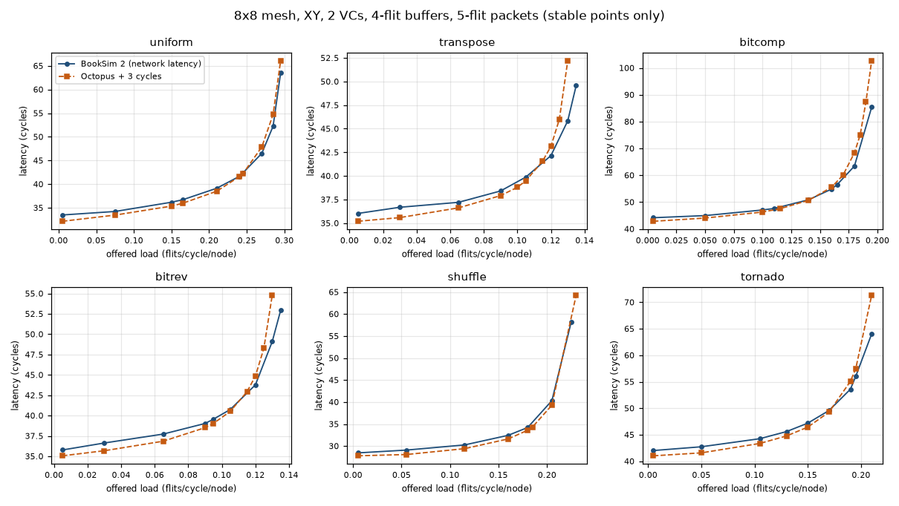
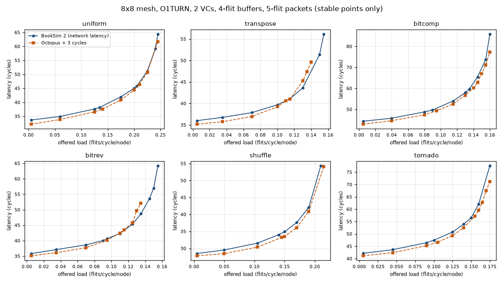
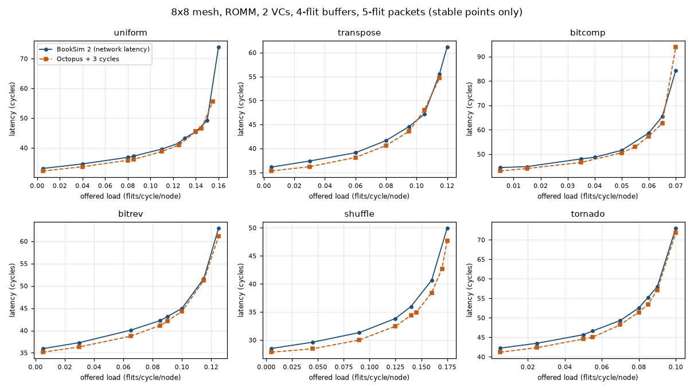
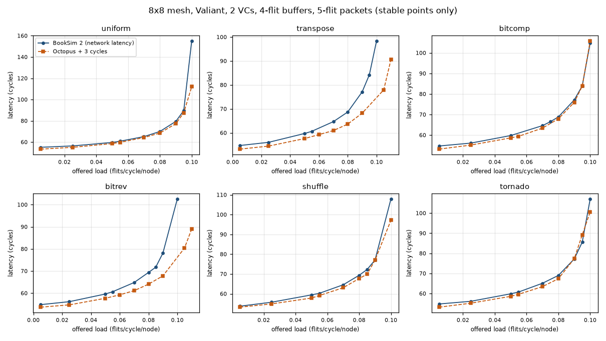
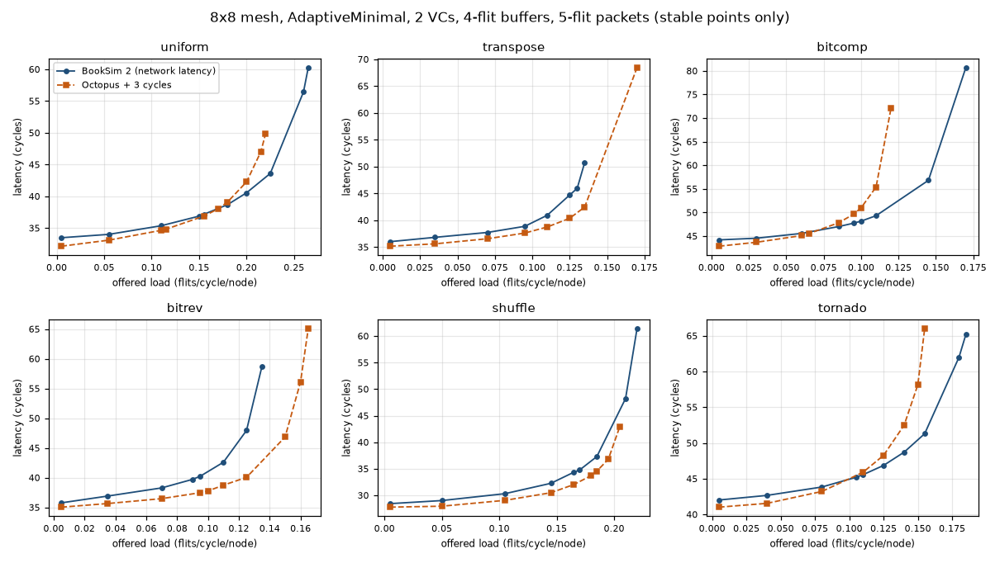

# Octopus NoC against BookSim 2

Status: 2026-11-22. Octopus at commit 6585fc6b (branch `network`) plus this work. BookSim 2 at
commit `28f43299f1706a3160ffac721ca461d74eb6e618` (github.com/booksim/booksim2, the head of its
master branch, June 2017). Platform: Linux on aarch64.

This document compares the flit-level network of Octopus with BookSim 2 on a 4x4 and an 8x8 mesh.
It lists the setup, how each Octopus key maps onto a BookSim key, the agreement criteria (written
before the 8x8 runs), the results per case and where the two simulators differ and why.

Contents

1. How to rerun
2. Setup
3. Definitions checked in BookSim's source
4. Agreement criteria
5. Results: 4x4 (S8-BOOKSIM)
6. Results: 8x8 matrix
7. Differences and their causes
8. Suspected Octopus bugs
9. Conclusions

---

## 1. How to rerun

```
bash test/network/run.sh 8            # step 8 plus the regression suite
```

Step 8 clones BookSim into `test/network/out/booksim2` (gitignored), checks out the pinned commit
and builds it with `make`. It needs `bison`, `flex`, `git`, `make` and `g++` on `PATH` (or bison and
flex in `$HOME/local/bin`). On Windows the 4x4 test builds and runs BookSim under WSL as before.
The 8x8 matrix needs the native build and is XFAIL under WSL.

Step 8 also makes a second copy, `test/network/out/booksim2-valfix`, with a one-line fix to
BookSim's `valiant_mesh` (§7.1). The Valiant cases use that copy. Every other case uses stock
BookSim.

The 8x8 matrix is `test/network/booksim/compare.py` (standard-library Python, no numpy). It can be
run alone:

```
python3 test/network/booksim/compare.py --octopus build/Octopus_Simulator \
    --booksim test/network/out/booksim2/src/booksim \
    --valiant-booksim test/network/out/booksim2-valfix/src/booksim \
    --cfg test/network/booksim/mesh88.cfg --out test/network/out/s8/mesh88
```

It writes `points.csv` (every run), `cases.csv` (one row per case) and `patternmap.csv`. The copies
committed under `test/network/ref/booksim/` are the data behind this document. The plots in
`docs/imgs/booksim/` come from `test/network/booksim/plot.py points.csv docs/imgs/booksim`, which
needs matplotlib and is not part of the suite. The whole matrix takes about 2.5 minutes on an idle 20-core machine (14 parallel runs), and longer on a shared one.
Both simulators are deterministic, so a rerun gives the same numbers.

## 2. Setup

Both sides model the same network:

| item | BookSim (`mesh88.cfg`, `mesh44_dor.cfg`) | Octopus (`-p` overrides on `NetworkOnly`) |
|---|---|---|
| topology | `topology = mesh; k = 8; n = 2` | `interconnect.topology(s)=grid2d`, `dims(vi)=8,8`, endpoint `i` at router `i` (`node_map[i]=i`) |
| VCs | `num_vcs = 2` (1 for the 4x4 test) | `vcs_per_class(i)=2`; one traffic class is used (`cls 2`) |
| buffers | `vc_buf_size = 4`, `wait_for_tail_credit = 0` | `vc_depth(i)=4`; an output VC is released when the tail is sent |
| packet | `packet_size = 5` flits | 64-byte payload, 8-byte header, 16-byte flits: `ceil(72/16) = 5` flits |
| router pipeline | `router = iq`, `routing_delay = 0` (lookahead), `vc_alloc_delay = 1`, `sw_alloc_delay = 1`, `st_final_delay = 1` | `router_latency(i)=3` (head arrival to its earliest switch traversal) |
| links and credits | channel latency 1, `credit_delay = 1` | `link_latency 1`, `credit_latency(i)=4` |
| switch allocator | `sw_allocator = separable_input_first` | `sa_allocator(s)=input_first` |
| VC allocator | `vc_allocator = separable_input_first` | per output VC, one winner per tick (spec §11.2) |
| arbitration | `arb_type = round_robin`, `priority = age` | `arbiter_type(s)=FCFSArbiter` (oldest packet first) |
| injection | Bernoulli, `injection_rate_uses_flits = 1`, infinite source queue | Bernoulli per tick, `rate` packets per 1000 ticks, `inject_queue_depth 16` packets, closed loop |
| measurement | `sim_type = latency`, 3 warm-up periods of 10 000 cycles, then samples of 10 000 until three converge (at most 10), then a drain | every packet of a run of 20 000 injection cycles (50 000 at the zero-load point), then a drain |

The 4x4 test keeps its original configuration (`mesh44_dor.cfg`: 1 VC, iSLIP allocators, no
priority, Octopus defaults `output_first` and `FCFSArbiter`).

**Pipeline mapping.** `credit_latency 4` is the mapping S8-BOOKSIM already used: a BookSim buffer
slot is held until its flit has left through the switch, so the credit loop is longer than the
link. `router_latency 3` matches BookSim's VA, SA and ST stages. A single BookSim packet traced with
`watch_packets` (4x4, node 13 to node 2, 5 routers) shows the head reach each next router 4 cycles
after the previous one, as in Octopus (`router_latency + link_latency`). The trace also shows three
cycles that Octopus does not model: one on BookSim's injection channel, one on its ejection channel
and one for the retire step at the destination node. Octopus's local links cost nothing (spec §7.2).
The head of that packet entered the injection channel at 1001 and retired at 1023, which is
`4R + 2 = 22` cycles with `R = 5` routers. Octopus ejects the same head `4R - 1 = 19` ticks after
injection. So every comparison adds 3 cycles to Octopus's latency.

The tail adds one more residual. In that trace BookSim's tail retired 6 cycles after its head
(4 for serialisation, 2 credit stalls). Octopus's tail on the same route arrives 5 ticks after its
head (1 credit stall). The credit loops differ in detail: a BookSim slot turns over in 7 cycles for
a head and 6 for a body flit, an Octopus slot in 8 ticks for a head and 5 for a body flit. That
leaves Octopus about one cycle faster per packet at zero load.

**Routing mapping.**

| Octopus | BookSim `routing_function` |
|---|---|
| `XY` | `dor` (`dim_order_mesh`) |
| `O1TURN` | `xy_yx` (`xy_yx_mesh`) |
| `ROMM` | `romm` (`romm_mesh`) |
| `Valiant` | `valiant` (`valiant_mesh`), with the fix of §7.1 |
| `AdaptiveMinimal` with `escape_vc(i)=0` | `min_adapt` (`min_adapt_mesh`) |

## 3. Definitions checked in BookSim's source

All file references are to `src/` of the pinned BookSim commit.

**Node numbering.** `networks/kncube.cpp` gives node `n` the coordinate `(n / k^d) % k` in dimension
`d`, so dimension 0 (x) varies fastest. `dor_next_mesh` in `routefunc.cpp` corrects dimension 0
first, which is XY. Octopus's `Lattice::coord` uses the same order (dimension 0 fastest, spec §5)
and `XY` corrects dimension 0 first. With `node_map[i] = i` the endpoint index and the BookSim node
id are the same router. S8-PATTERN-MAP checks this end to end (§6.1).

**Traffic patterns** (`traffic.cpp`). With `N = 64` nodes and `b = 6` address bits:

| pattern | BookSim | Octopus (spec §18) | same? |
|---|---|---|---|
| uniform | `RandomInt(N - 1)`, which is inclusive, so a node sends 1/N of its packets to itself | uniform over the other `N - 1` endpoints | no: see below |
| transpose | swap the high and low `b/2` bits, which swaps x and y | the endpoint at the router with swapped coordinates | yes, except the 8 diagonal nodes |
| bitcomp | `~s & (N - 1)` | `~i` over `b` bits | yes |
| bitrev | the `b` bits reversed | the `b` bits reversed | yes |
| shuffle | rotate left by one bit | rotate left by one bit | yes |
| tornado | per dimension `(c + (k + 1)/2 - 1) mod k`, with `xr = 1` | per dimension `(c + ceil(k/2) - 1) mod k` | yes |

Fixed points, where a node's partner is itself: transpose has 8 (the diagonal), bitrev 8 (the bit
palindromes), shuffle 2 (all zeros and all ones). BookSim sends those packets to the node itself.
Octopus makes a bitrev or shuffle fixed point send nothing. For transpose Octopus instead sends a
diagonal node's packets to the first other endpoint (spec §18, "its historical fallback"), which
turns endpoint 0 into a hot spot. The comparison therefore sets `generator[d].pattern(s)=none` for
the 8 diagonal endpoints. On the BookSim side every statistic is computed over packets whose source
and destination differ, from the `pair_stats` matrices (`pair_sent`, `pair_nlat`, `pair_plat`).
For uniform the BookSim injection rate is scaled by `N/(N - 1)` so that both sides offer the same
load to other nodes.

**VC split.** `xy_yx_mesh` draws XY or YX per packet at its first router and uses the lower half of
the VCs for XY, the upper half for YX. `romm_mesh` and `valiant_mesh` draw the intermediate at the
first router (`rand_min_intr_mesh`: per dimension uniform in the closed range between source and
destination for ROMM, `RandomInt(N - 1)` over all routers for Valiant). Phase 0 uses the lower half
of the VCs, phase 1 the upper half. All three let the destination router eject on any VC. Octopus
splits each class into A = `[0, vcs/2)` and B = `[vcs/2, vcs)` the same way (spec §10.2), and draws
the same distributions. With 2 VCs each set is one VC on both sides. `min_adapt_mesh` keeps VC 0 as
a dimension-order escape VC at priority 0 and offers VCs 1 and up on every minimal direction at
priority 1. A packet that is on VC 0 stays on it. Octopus `AdaptiveMinimal` with `escape_vc 0` has
the same channel sets and the same "stay on the escape network" rule, but a different selection
(§7.3).

**Allocators and arbiters.** `separable_input_first.cpp`: each input arbiter picks one request, then
each output arbiter picks one input. `roundrobin_arb.hpp`, `Supersedes`: a request wins on higher
priority first and on round-robin order among equal priorities. With `priority = age`
(`trafficmanager.cpp`) a flit's priority is `INT_MAX - ctime`, so the oldest packet wins. Octopus's
`input_first` lets each input port offer one ready VC (chosen by its arbiter), then each output
elects among those (spec §11.3). `FCFSArbiter` elects the lowest injection sequence number, which
is the oldest packet. The two are the same policy except that BookSim breaks ties of equal age
round robin. Octopus has no ties. Octopus applies its decisions in a fixed router and port order
within a tick (spec §13.2). BookSim evaluates all allocators of a router at once.

**Packet size.** `packet_size = 5` with `injection_rate_uses_flits = 1`: the packet rate is the
injection rate divided by 5. Octopus: 5 flits, `rate / 1000` packets per tick. One Octopus rate step
is therefore 0.005 flits per cycle per node. All offered loads in this document are on that grid.

**Latency.** BookSim records, for each packet created during the measurement window, the packet
latency `plat = tail atime - head ctime` (creation, so it includes the source queue) and the network
latency `nlat = tail atime - head itime` (`itime` is set when the head is written to the injection
channel). Warm-up periods are discarded. Octopus records, for every packet, the time from the head
entering its source router's local input VC to the tail's ejection (spec §15.4). That has no source
queue in it, so the matched quantity is BookSim's `nlat`, compared with Octopus's mean plus the 3
terminal cycles of §2. Octopus has no warm-up window. Its 20 000-cycle runs make the start-up and
drain transients a small share of the samples.

**Saturation throughput.** BookSim: `sim_type = throughput` at `injection_rate = 1.0`, so every
source is backlogged. The accepted rate is read from `sent_packets` and the pair matrix, over
traffic to other nodes, per active source. Octopus: `rate 1000` (every source backlogged) for 10 000
and for 30 000 cycles. The difference of the delivered packet counts, divided by 20 000 cycles and
the active sources, removes the start-up fill of the injection queues.

**Knee.** The lowest offered load on the 0.005 grid at which a source can no longer keep up, found
by bisection on each side. Octopus: some generator's push was refused on more than 1 percent of the
cycles (its 16-packet injection queue was full). BookSim: the run is unstable by BookSim's own test,
or some source's mean queueing delay (`plat - nlat` over its packets) exceeds the time to inject 16
packets at the offered rate. The second part was added after the first matrix run, see §7.2.

## 4. Agreement criteria

Written before the 8x8 runs. Latencies are in BookSim's units (Octopus plus 3 cycles).

| id | quantity | criterion |
|---|---|---|
| C1 | zero-load latency, offered 0.005 flits/cycle/node | within 1.5 cycles. The tolerance covers the 1-cycle tail residual of §2 plus sampling noise |
| C2 | saturation throughput | within 10 percent of the larger value |
| C3 | knee | within 10 percent of the larger value, or one grid step (0.005) |
| C4 | latency curve at 0.25, 0.5, 0.7 and 0.8 of the lower knee | within max(2 cycles, 10 percent of BookSim's value) at every point, and both sides stable there. The 0.9 point is reported but not gated |

A case passes when C1 to C4 hold. Test ids, per routing over the six patterns:
S8-88-XY, S8-88-O1TURN, S8-88-ROMM, S8-88-VALIANT. They PASS when every pattern passes. They are
XFAIL when the only misses are the ones this document explains (§7, listed in `KNOWN_MISSES` of
`compare.py`). Any other miss is a FAIL. S8-88-ADAPTIVE is report only from the start, because the
two adaptive algorithms are known to select outputs differently: it PASSes if C1 to C4 hold and is
XFAIL otherwise.

## 5. Results: 4x4 (S8-BOOKSIM)

The original test, now native on Linux. Uniform traffic, DOR, 1 VC.

| | Octopus | BookSim |
|---|---|---|
| first offered rate past saturation (flits/cycle/node) | 0.35 | 0.30 |
| accepted there | 0.288 | 0.279 |
| relative difference | 3 percent | |

Criterion: within 10 percent. PASS.

## 6. Results: 8x8 matrix

Five routings, six patterns, 2 VCs. Data: `test/network/ref/booksim/cases.csv` (one row per case)
and `points.csv` (every point of every curve). In the tables, "diff" is Octopus minus BookSim and
the worst curve difference is in cycles over the gated points.

### 6.1 Pattern mapping (S8-PATTERN-MAP)

BookSim at 0.05 flits/cycle/node writes its pair matrix. For each source it names one destination.
Octopus at the same load writes per-endpoint send and receive counts. For every source `i` with
BookSim destination `j != i`, Octopus's receive count at `j` equals its send count at `i`. Every
BookSim fixed point sends nothing in Octopus. Result for transpose (8 fixed points), bitcomp (0),
bitrev (8), shuffle (2) and tornado (0): PASS, no mismatch.

### 6.2 Tables

#### XY (BookSim `dor`)

| pattern | zero-load Octopus+3 / BookSim | diff | saturation Octopus / BookSim | rel. diff | knee Octopus / BookSim | worst curve diff (to 0.8 knee) | criteria missed |
|---|---|---|---|---|---|---|---|
| uniform | 32.15 / 33.49 | -1.33 | 0.298 / 0.296 | 0.8% | 0.300 / 0.300 | -0.8 | none |
| transpose | 35.20 / 36.03 | -0.83 | 0.244 / 0.238 | 2.3% | 0.135 / 0.140 | -1.1 | none |
| bitcomp | 42.86 / 44.19 | -1.33 | 0.208 / 0.203 | 2.3% | 0.200 / 0.200 | -0.9 | none |
| bitrev | 35.06 / 35.77 | -0.72 | 0.172 / 0.173 | 0.7% | 0.135 / 0.140 | -1.0 | none |
| shuffle | 27.78 / 28.44 | -0.66 | 0.340 / 0.323 | 4.8% | 0.235 / 0.230 | -1.0 | none |
| tornado | 41.02 / 42.02 | -0.99 | 0.233 / 0.235 | 1.1% | 0.215 / 0.215 | -1.1 | none |

S8-88-XY: PASS, 6 of 6.



#### O1TURN (BookSim `xy_yx`)

| pattern | zero-load Octopus+3 / BookSim | diff | saturation Octopus / BookSim | rel. diff | knee Octopus / BookSim | worst curve diff (to 0.8 knee) | criteria missed |
|---|---|---|---|---|---|---|---|
| uniform | 32.19 / 33.69 | -1.50 | 0.250 / 0.247 | 1.2% | 0.250 / 0.250 | -1.1 | none |
| transpose | 35.18 / 36.01 | -0.83 | 0.200 / 0.186 | 6.7% | 0.145 / 0.160 | -1.0 | none |
| bitcomp | 42.95 / 44.35 | -1.40 | 0.169 / 0.161 | 4.8% | 0.165 / 0.165 | -1.4 | none |
| bitrev | 35.10 / 35.82 | -0.72 | 0.168 / 0.168 | 0.3% | 0.140 / 0.160 | -1.0 | C3 |
| shuffle | 27.82 / 28.49 | -0.68 | 0.263 / 0.259 | 1.4% | 0.220 / 0.215 | -1.5 | none |
| tornado | 41.13 / 42.11 | -0.99 | 0.187 / 0.181 | 3.6% | 0.180 / 0.180 | -1.4 | none |

S8-88-O1TURN: 5 of 6. The bitrev knee misses C3 (12.5 percent, §7.2). XFAIL.



#### ROMM (BookSim `romm`)

| pattern | zero-load Octopus+3 / BookSim | diff | saturation Octopus / BookSim | rel. diff | knee Octopus / BookSim | worst curve diff (to 0.8 knee) | criteria missed |
|---|---|---|---|---|---|---|---|
| uniform | 32.23 / 33.09 | -0.86 | 0.154 / 0.159 | 2.8% | 0.160 / 0.165 | -1.0 | none |
| transpose | 35.29 / 36.10 | -0.81 | 0.195 / 0.187 | 3.9% | 0.120 / 0.125 | -1.2 | none |
| bitcomp | 43.10 / 44.49 | -1.39 | 0.067 / 0.069 | 3.5% | 0.075 / 0.075 | -1.4 | none |
| bitrev | 35.14 / 35.95 | -0.80 | 0.154 / 0.152 | 1.1% | 0.130 / 0.130 | -1.3 | none |
| shuffle | 27.83 / 28.50 | -0.67 | 0.263 / 0.259 | 1.5% | 0.180 / 0.180 | -1.6 | none |
| tornado | 41.19 / 42.23 | -1.05 | 0.100 / 0.103 | 2.7% | 0.105 / 0.105 | -1.1 | none |

S8-88-ROMM: PASS, 6 of 6.



#### Valiant (BookSim `valiant` with the fix of §7.1)

| pattern | zero-load Octopus+3 / BookSim | diff | saturation Octopus / BookSim | rel. diff | knee Octopus / BookSim | worst curve diff (to 0.8 knee) | criteria missed |
|---|---|---|---|---|---|---|---|
| uniform | 53.38 / 55.10 | -1.72 | 0.100 / 0.099 | 0.5% | 0.105 / 0.105 | -1.5 | C1 |
| transpose | 53.19 / 54.70 | -1.50 | 0.112 / 0.100 | 11.0% | 0.115 / 0.105 | -5.1 | C1, C2 |
| bitcomp | 53.18 / 54.71 | -1.53 | 0.097 / 0.093 | 3.3% | 0.105 / 0.105 | -1.2 | C1 |
| bitrev | 53.67 / 54.81 | -1.14 | 0.112 / 0.101 | 10.1% | 0.115 / 0.105 | -5.3 | C2 |
| shuffle | 53.23 / 53.72 | -0.49 | 0.102 / 0.101 | 1.3% | 0.105 / 0.105 | -1.7 | none |
| tornado | 53.21 / 54.80 | -1.59 | 0.098 / 0.098 | 0.0% | 0.105 / 0.105 | -1.7 | C1 |

S8-88-VALIANT: 1 of 6. C1 misses by at most 0.22 cycles (§7.4). C2 misses on transpose and bitrev
are a workload difference (§7.1). XFAIL.



#### AdaptiveMinimal (BookSim `min_adapt`), report only

| pattern | zero-load Octopus+3 / BookSim | diff | saturation Octopus / BookSim | rel. diff | knee Octopus / BookSim | worst curve diff (to 0.8 knee) | criteria missed |
|---|---|---|---|---|---|---|---|
| uniform | 32.15 / 33.49 | -1.34 | 0.208 / 0.270 | 22.9% | 0.225 / 0.270 | -0.9 | C2, C3 |
| transpose | 35.18 / 36.03 | -0.85 | 0.248 / 0.237 | 4.5% | 0.175 / 0.140 | -2.2 | C3 |
| bitcomp | 42.86 / 44.19 | -1.34 | 0.116 / 0.176 | 34.2% | 0.125 / 0.175 | +2.8 | C2, C3 |
| bitrev | 35.05 / 35.77 | -0.73 | 0.177 / 0.166 | 6.7% | 0.170 / 0.140 | -3.9 | C3 |
| shuffle | 27.78 / 28.44 | -0.66 | 0.260 / 0.308 | 15.5% | 0.210 / 0.225 | -2.3 | C2 |
| tornado | 41.02 / 42.02 | -1.00 | 0.133 / 0.188 | 29.5% | 0.160 / 0.190 | +1.4 | C2, C3 |

S8-88-ADAPTIVE: 0 of 6 by C1 to C4. Zero load and the curve below the knee agree. Saturation does
not (§7.3). XFAIL.



### 6.3 Summary

| quantity | cases within the criterion (of 24 oblivious ones) | spread |
|---|---|---|
| C1 zero-load latency | 20 | Octopus lower by 0.5 to 1.7 cycles in every case |
| C2 saturation throughput | 22 | 0.0 to 11 percent. The two misses are Valiant with fixed points |
| C3 knee | 23 | 0 to 12.5 percent |
| C4 curve below 0.8 of the knee | 24 | worst 5.3 cycles (Valiant bitrev, 7 percent) |

For XY and ROMM every criterion holds on every pattern. Below saturation the two simulators agree
to within about one cycle once BookSim's terminal cycles are subtracted.

## 7. Differences and their causes

### 7.1 BookSim's Valiant deadlocks, and its self packets cross the network

Stock `valiant_mesh` (routefunc.cpp, the `if(r->GetID() != f->dest)` around line 1314) skips the VC
split at the destination router in both phases. A phase-0 packet whose path to the intermediate
passes its own destination router may then leave that router on a phase-1 VC. That couples the
two VC sets and closes a cycle of channel dependencies. With every source backlogged
(`sim_type = throughput`, `injection_rate = 1.0`) stock BookSim stopped moving flits and printed
`WARNING: Possible network deadlock.` without end, for uniform, transpose, bitrev and shuffle. It
did not for bitcomp and tornado. `romm_mesh` has the same line, but a ROMM intermediate lies in the
minimal box, so phase 0 never passes the destination before the intermediate.

The fix applies the split whenever the packet is in phase 0:
`if((r->GetID() != f->dest) || (f->ph == 0))`. With it, uniform at full load runs to completion and
accepts 0.101 flits/cycle/node. Step 8 builds this copy for the Valiant cases. Octopus's `Valiant`
does not have the problem: it uses set A until the intermediate, wherever that is.

A second Valiant difference is in the workload. BookSim routes a packet whose destination is its own
node through the random intermediate like any other packet. Under transpose and bitrev, 8 of the 64
nodes are fixed points. In BookSim they add 12.5 percent more load to the network, which Octopus
(where those generators are silent) does not carry. The saturation throughput differs by 11 and
10 percent on exactly those two patterns. Shuffle has 2 fixed points (3 percent more load) and
differs by 1.3 percent. With XY, O1TURN and ROMM a self packet never leaves its router, so the
other routings are not affected. Matching this would need Octopus generators that send to
themselves, which Octopus does not offer.

### 7.2 The knee depends on how instability is detected

BookSim's own stability test looks at the mean packet latency over all sources. Under a permutation
one saturated flow among 64 barely moves that mean. In the first matrix run, with BookSim's test
alone, BookSim reported O1TURN transpose as stable at 0.160 although seven of its sources had mean
queueing delays above 2 100 cycles. Octopus's test is per source. The first run therefore put
Octopus's knee lower on every permutation, by up to 15 percent:

| case | knee Octopus | BookSim, its own test | BookSim, per-source test |
|---|---|---|---|
| XY transpose | 0.135 | 0.150 | 0.140 |
| XY bitrev | 0.135 | 0.150 | 0.140 |
| O1TURN transpose | 0.145 | 0.165 | 0.160 |
| O1TURN bitrev | 0.140 | 0.165 | 0.160 |
| ROMM transpose | 0.120 | 0.130 | 0.125 |
| ROMM bitrev | 0.130 | 0.140 | 0.130 |

The measurement was then made symmetric (§3, "Knee"). The tolerances did not change. One miss is
left: O1TURN bitrev, 0.140 against 0.160. At 0.135 Octopus's latency is 52.2 cycles and BookSim's
48.7, so Octopus does congest a little earlier on this case. The two detectors also use different
thresholds (a full 16-packet queue at times against a mean delay of 16 packet times), which matters
when a flow saturates gradually. The saturation throughputs of the case agree within 0.3 percent.

### 7.3 Adaptive routing selects differently

Zero-load latency and the curve below the knee agree (C1 and C4 hold on all six patterns). The
saturation throughput does not: Octopus is 23 to 34 percent lower on uniform, bitcomp and tornado
and 5 to 7 percent higher on transpose and bitrev. The selection functions differ:

- BookSim gives the VC allocator every free output VC on every minimal port (adaptive VCs at
  priority 1, the escape VC at priority 0) and lets allocation choose.
- Octopus picks one primary port, the minimal port whose adaptive VCs hold the most credits, ties to
  the lowest port. It counts credits whether or not the VC is held by another packet
  (`Routing.cpp`, `AdaptiveMinimal::nextHop`). When that VC is held the head cannot be granted it,
  and VC allocation's second pass sends it to the escape VC (spec §11.2). Once there it stays on the
  dimension-order escape network for the rest of its path.

Under load many packets therefore drop onto the single escape VC, and Octopus's adaptive routing
carries less than its own XY on 2 VCs (0.208 against 0.298 on uniform). BookSim's `min_adapt` also
loses to `dor` on uniform (0.270 against 0.296), but by less. This is a design choice of the spec,
not a fault, and a definitional difference for the comparison. It may be worth revisiting (§8.2).

### 7.4 One cycle of tail residual at zero load

Every case has Octopus lower than BookSim by 0.5 to 1.7 cycles at zero load, and by about one cycle
along the whole curve. This is the credit-loop residual of §2: BookSim's tail stalls a cycle more
per packet. It grows on the long Valiant paths (about 12 routers), where four of six cases exceed the
1.5-cycle tolerance by at most 0.22 cycles. A sharper pipeline mapping would need BookSim's slot
residency (body flits held for SA and ST) modelled in Octopus, which has no such knob.

### 7.5 Smaller differences

- Uniform traffic in BookSim includes 1/64 self traffic. It is excluded from the statistics and the
  injection rate is scaled (§3). The self packets still use the local ports of their router.
- Octopus sources are closed loop (16-packet queue), BookSim's are infinite. Below the knee the
  queue never fills (no refused push at any gated point). Above it, BookSim's packet latency grows
  without bound while Octopus's network latency plateaus. Only network latency is compared.
- Octopus has no warm-up window. BookSim discards 30 000 warm-up cycles.
- Ties of equal age are broken round robin in BookSim. Octopus has none.

## 8. Suspected Octopus bugs

### 8.1 AdaptiveMinimal deadlocks with 3 VCs on an 8x8 mesh

Repro (Octopus at 6585fc6b, `ids` = `0,1,...,63`, `NM` = `-p interconnect.node_map[i](i)=i` for
every `i`):

```
OCTOPUS_HANG_DUMP=2000 build/Octopus_Simulator -s NetworkOnly \
  -p "interconnect.topology(s)=grid2d" -p "interconnect.dims(vi)=8,8" -p "interconnect.component_ids(vi)=$ids" $NM \
  -p "interconnect.vcs_per_class(i)=3" -p "interconnect.routing(s)=AdaptiveMinimal" -p "interconnect.escape_vc(i)=0" \
  -p "interconnect.router_latency(i)=3" -p "interconnect.credit_latency(i)=4" -p "interconnect.sa_allocator(s)=input_first" \
  -p "generator[*].pattern(s)=uniform" -p "generator[*].rate(i)=1000" \
  -p "generator[*].packets(i)=-1" -p "generator[*].cycles(i)=20000" -o out
```

It stops at tick 6 530 with `Network: no flit moved for 2000 ticks with 8 packets in flight: the
network is wedged` and exit status 2. Without `OCTOPUS_HANG_DUMP` the run never ends (the network
watchdog is off by default). The dump shows 8 packets, each at the front of an adaptive VC (VC 1 or
2) with 4 flits, each already granted an adaptive output VC with 0 credits, and no credit in
return: a cycle of held adaptive VCs. For example packet seq 10685 at router 19 holds south VC 1,
whose downstream FIFO at router 27 is full of packet seq 10362, which holds east VC 1, and so on.

The construction check accepted the configuration. A likely mechanism: an output VC is released
when the tail is sent (spec §8.3), so a packet can be granted an adaptive VC whose FIFO still holds
another packet. Duato's condition is checked at VA only ("a waiting head can always use the escape
network"), but a head that has already been granted an adaptive VC and then waits for credits
cannot fall back. With non-atomic VC reallocation the adaptive VCs can then form a cycle.

Context: the same run with 2 or 4 VCs completes, as do 3 VCs with Octopus's default pipeline
(`router_latency 2`, `credit_latency` = link, `output_first`) over 100 000 cycles, 3 VCs with only
two of the three overrides, and 3 VCs under tornado. BookSim's `min_adapt` with 3 VCs at full load
completes (0.340 flits/cycle/node). Not fixed here.

### 8.2 AdaptiveMinimal selection by credit count (performance, not correctness)

§7.3. Choosing the primary port by the credits of VCs that may be held, and then falling to the
escape network for good, makes `AdaptiveMinimal` carry less than `XY` under uniform traffic
(8x8, 2 VCs, BookSim pipeline: 0.208 against 0.298 flits/cycle/node; 0.221 against 0.308 in a
10 000-cycle run). Repro: `compare.py --routings AdaptiveMinimal,XY --patterns uniform`. A selection
that only counts free VCs, or a VA that may try the other minimal port before the escape, would
likely close most of the gap.

### 8.3 Transpose fallback (documented behaviour)

Not a bug, since the spec states it. A transpose generator on the diagonal sends to the first
other endpoint, so under transpose endpoint 0 receives from the 8 diagonal nodes as well as its
partner. The comparison silences the diagonal generators to match BookSim (§3).

## 9. Conclusions

- With the pipeline mapped (`router_latency 3`, `credit_latency 4`) and BookSim's three terminal
  cycles added, Octopus reproduces BookSim's latency under XY, O1TURN and ROMM to about one cycle
  from zero load to 0.8 of the knee, on all six patterns. Saturation throughput agrees within
  7 percent and the knee within 12.5 percent, mostly within one grid step.
- Valiant agrees within 3.3 percent on saturation where the workloads are the same. It differs by
  10 to 11 percent where BookSim routes self packets through the network. Stock BookSim's
  `valiant_mesh` deadlocks under full load. A one-line fix is applied for the comparison.
- The two minimal adaptive algorithms agree at low load and differ at saturation, because their
  selection functions differ. Octopus's `AdaptiveMinimal` also deadlocked once in this study (§8.1).
- The 4x4 S8-BOOKSIM test now runs natively on Linux and passes (3 percent).
