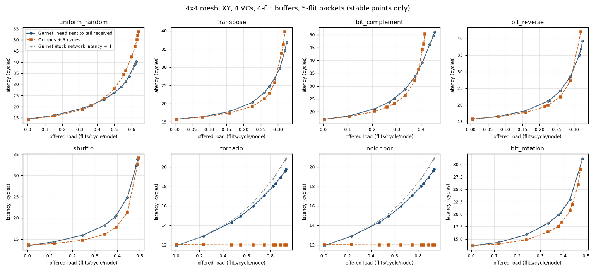
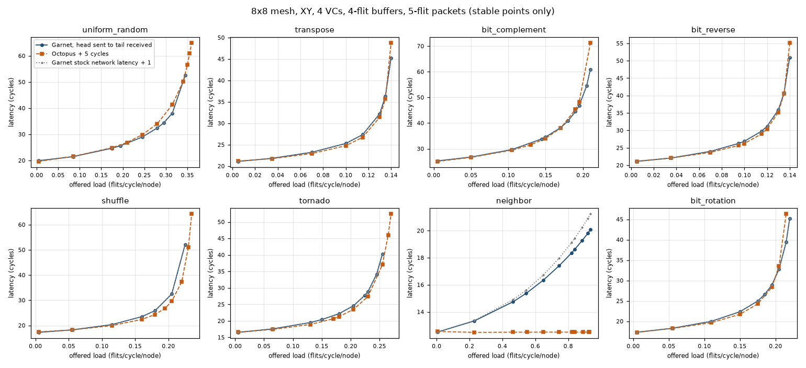

# Octopus NoC against gem5 Garnet

Status: 2026-11-27. Octopus at commit 1a08e88a (branch `network`), `build/Octopus_Simulator`. Another
session rebuilt that binary during the study with uncommitted changes outside the network
(directory protocol, mesh system, external CPU); five Octopus runs repeated with the new binary
gave byte-identical `NetworkStats.csv`. gem5 v25.1.0.1 (commit `c8222cc`, "misc: Hotfix Release: v25.1.0.1"),
Garnet 3.0, built as `Garnet_standalone` in a separate worktree. Platform: Linux on aarch64.

This document compares the flit-level network of Octopus with gem5's Garnet on a 4x4 and an 8x8
mesh under synthetic traffic, in the same way as `docs/NoC_BookSim_Validation.md` does for
BookSim 2. It lists the setup, how each Octopus key maps onto a Garnet parameter (checked in
Garnet's source), the agreement criteria (written before the 8x8 runs), the results per case and
where the two simulators differ and why.

Contents

1. How to rerun
2. Setup
3. Definitions checked in Garnet's source
4. Agreement criteria
5. Results: 4x4
6. Results: 8x8
7. Differences and their causes
8. Suspected bugs
9. Simulation speed
10. Conclusions

---

## 1. How to rerun

Garnet needs its own build, which must not touch another gem5 build in the same tree. The study
uses a separate worktree of the same commit:

```
git -C <gem5> worktree add --detach <gem5-garnet> c8222cc
cd <gem5-garnet>
git apply <octopus>/test/network/garnet/gem5-validation.patch
scons defconfig build/NULL build_opts/Garnet_standalone
nice -n 19 scons build/NULL/gem5.opt -j6
```

In this gem5 version `build_opts/Garnet_standalone` holds `RUBY=y`, `PROTOCOL="Garnet_standalone"`
and `RUBY_PROTOCOL_Garnet_standalone=y`. The older `scons build/NULL/gem5.opt
PROTOCOL=Garnet_standalone` form is gone (Kconfig). The first build takes about 25 minutes at `-j6`
on this machine.

The patch (`test/network/garnet/gem5-validation.patch`) changes no timing. It adds:

- a tester parameter `skip_self` (default off): `uniform_random` then draws from the other
  `N - 1` nodes, and a permutation fixed point sends nothing. This is Octopus's traffic (§3);
- one statistic pair, `packet_head_sent_latency` and `packets_head_sent_received` per vnet: from
  the tick the source NI sends a packet's head flit to the tick the destination NI receives its
  tail (§3, "Latency").

With the patch, 135 Garnet runs of the 4x4 matrix gave the same `packet_network_latency`,
`flits_received` and `m_stall_time` as without it.

The matrix is `test/network/garnet/compare_garnet.py` (standard-library Python). Every gem5 run
goes through `test/network/garnet/garnet_window.py`, a copy of
`configs/example/garnet_synth_traffic.py` with a warm-up window, a measurement window and the
`skip_self` switch:

```
python3 test/network/garnet/compare_garnet.py --octopus build/Octopus_Simulator \
    --gem5 <gem5-garnet> --k 8 --out test/network/out/garnet/mesh88        # and --k 4
```

It writes `calibration.csv`, `patternmap.csv`, `points.csv` (every run, with its wall time, which
is taken under parallel load) and `cases.csv` (one row per pattern). The copies under `test/network/ref/garnet/` are the
data behind this document. The plots in `docs/imgs/garnet/` come from
`test/network/garnet/plot_garnet.py docs/imgs/garnet <points.csv>...` (matplotlib). Gem5 runs at
`nice -n 19`, at most 6 at a time (`--jobs`). Both simulators are deterministic, so a rerun gives
the same numbers. Two helpers produce the tables of §7.2: `test/network/garnet/sweep.py` (accepted
load and latency past the knee, `sweep88.csv`) and `test/network/garnet/fairness.py` (per-source
throughput of the saturation runs, `fairness.csv`). `--garnet-ordered` reruns the matrix with
Garnet's vnet declared ordered (§7.1, `mesh44_ordered/`, `mesh88_ordered/`). The 4x4 matrix takes
about 1.5 minutes and the 8x8 matrix about 12.5 minutes with 6 parallel runs on this machine.

## 2. Setup

Both sides model the same network. Garnet keeps its defaults where Octopus can follow them (one
cycle per router, one cycle per link, 4 VCs, 4-flit buffers, 16-byte flits) and Octopus is mapped
onto them.

| item | Garnet (`garnet_window.py` options) | Octopus (`-p` overrides on `NetworkOnly`) |
|---|---|---|
| topology | `--topology Mesh_XY --mesh-rows k --num-cpus N --num-dirs N`: L1 `i` and directory `i` at router `i` | `interconnect.topology(s)=grid2d`, `dims(vi)=k,k`, endpoint `i` at router `i` (`node_map[i]=i`) |
| traffic class | `--inj-vnet 2` (the 5-flit data vnet; vnets 0 and 1 stay empty) | class 2 |
| VCs | `--vcs-per-vnet 4` (default) | `vcs_per_class(i)=4` |
| buffers | `buffers_per_data_vc = 4` (default) | `vc_depth(i)=4` |
| packet | `MessageSizeType:Data` = 72 bytes, `ni_flit_size` 16 bytes: 5 flits | 64-byte payload, 8-byte header, 16-byte flits: 5 flits |
| router | `--router-latency 1` (default): buffer write, route, switch and VC allocation and switch traversal in the arrival cycle | `router_latency(i)=0` |
| links | `--link-latency 1`; a flit that traverses the switch in cycle `t` enters the link at `t + 1`: 2 cycles per hop | `link_latency(i)=2`: 2 cycles per hop |
| credits | a credit leaves with the flit's switch traversal, enters the credit link a cycle later and takes `link_latency`: usable upstream 2 cycles after the flit left | `credit_latency(i)=2` |
| VC allocation | inside switch allocation; an output VC is free again only when the tail's credit (the free signal) is back upstream (atomic) | VA per output VC; released when the tail is sent (non-atomic, spec §8.3) |
| switch allocation | separable input first: round robin over the VCs of an input port, then round robin over the input ports of an output | `sa_allocator(s)=input_first`, `arbiter_type(s)=RRArbiter` (rotates over the packet's source, spec §7.2, §11.1) |
| routing | `--routing-algorithm 1` (XY) | `routing(s)=XY` |
| injection | Bernoulli per cycle, `--injectionrate` packets/cycle/node, `--precision 6`; unbounded source MessageBuffer; the NI holds one packet per VC and sends one flit per cycle, round robin over its VCs | Bernoulli, `rate` packets per 1000 ticks, `inject_queue_depth` 16 packets (closed loop); one flit per tick, a started packet continues |
| clocks | `--sys-clock 1GHz --ruby-clock 1GHz` (one tester cycle = one network cycle) | one tick = one cycle |
| measurement | 10 000 warm-up cycles, statistics reset, then 20 000 measured cycles (50 000 at the zero-load point); no drain | every packet of 20 000 injection cycles (50 000 at the zero-load point), then a drain |

**Pipeline mapping and the offset.** The calibration (`calibration.csv`) sends one packet from
node 0 to nodes 1 to `k - 1` and to the far corner. Octopus's latency is `2 * hops + 4` (spec §13:
`R * router_latency + (R - 1) * link_latency + (f - 1)` with `R = hops + 1`), Garnet's
`packet_head_sent_latency` is `2 * hops + 9` and its stock `average_packet_network_latency`
`2 * hops + 8`, on both meshes and for every hop count. So the per-hop cost is the same and the
offsets are constants: 5 cycles for the head-sent quantity and 4 for the stock one. A
`RubyNetwork` trace of one packet (4x4, node 0 to node 3) shows where the 5 cycles go: the head is
sent by the NI at cycle 55 and reaches router 0 at 57 (2 cycles on the injection link, which
Octopus does not have: its local links cost nothing, spec §7.2); the tail leaves router 3 and
reaches the NI 2 cycles later (the ejection link); and the tail reaches router 0 one cycle late
(flits at 57, 58, 59, 60 and 62). That last cycle is the NI's credit loop: the NI reads returning
credits after it has scheduled its output for the cycle, so its loop is one cycle longer than a
router's, and the fifth flit of a 5-flit packet waits for the first credit. The stock quantity
starts at the flitisation (the same cycle at zero load) and subtracts one cycle, hence 4.

The calibration also runs one backlogged flow corner to corner:

| VCs, depth | Octopus (flits/cycle) | Garnet (flits/cycle) |
|---|---|---|
| 1, 2 | 0.500 | 0.333 |
| 1, 4 | 1.000 | 0.500 |
| 4, 4 | 1.000 | 1.000 |

With several VCs both reach the link rate, so the credit loop (4 cycles from a slot's release to
its refill on both) is matched. With one VC Garnet carries half or a third: an output VC is
reallocated only after the previous packet's tail credit is back, so one VC holds one packet at a
time, while Octopus pipelines packets back to back in the same VC. The matrix uses 4 VCs, where
this costs Garnet nothing on a single flow.

## 3. Definitions checked in Garnet's source

File references are to `src/` of gem5 `c8222cc`.

**Node numbering and routing.** `configs/topologies/Mesh_XY.py` puts router `i` at column
`i % k`, row `i / k` and attaches controller `i` of each type to router `i % N`.
`RoutingUnit::outportComputeXY` corrects x (`my_id % num_cols`) first, then y. Octopus's
`Lattice::coord` uses the same order and `XY` corrects dimension 0 first. The pattern check of
§6.1 confirms this end to end.

**Traffic patterns** (`cpu/testers/garnet_synthetic_traffic/GarnetSyntheticTraffic.cc`,
`generatePkt`). With `N = k * k`, node `s` at `(x, y)`:

| Garnet `--synthetic` | Garnet destination | Octopus | same? |
|---|---|---|---|
| `uniform_random` | `random(0, N - 1)`, inclusive: 1/N of the packets go to the sender | uniform over the other `N - 1` endpoints | with `skip_self`: yes |
| `transpose` | `(y, x)` | `transpose` | yes; diagonal (k fixed points) silenced on both |
| `bit_complement` | `(k - 1 - x, k - 1 - y)` | `bitcomp`, `~s` over `log2 N` bits | yes (k a power of two) |
| `bit_reverse` | `log2 N` bits reversed | `bitrev` | yes |
| `shuffle` | `2s` or `2s - N + 1`: rotate left by one bit | `shuffle` | yes |
| `tornado` | `((x + k/2 - 1) mod k, y)`: x only, `(int) ceil(radix/2)` is an integer division | `tornado` moves every dimension; the Garnet pattern is given as a table | no, table used |
| `neighbor` | `((x + 1) mod k, y)` | `neighbour` is `s + 1 mod N`; table used | no, table used |
| `bit_rotation` | `s / 2` or `s / 2 + N / 2`: rotate right by one bit | none; table used | table used |

"Table" means `generator[s].pattern(s)=hotspot` with `generator[s].hotspot_id(i)` = Garnet's
destination of `s`, which gives Octopus any permutation. Fixed points (transpose 8, bit_reverse 8,
shuffle 2, bit_rotation 2 on 8x8; 4, 4, 2, 2 on 4x4) send nothing on both sides: Octopus through
`pattern(s)=none`, Garnet through `skip_self`. On a 4x4 mesh Garnet's tornado (offset 1) is the
same permutation as its neighbor. Garnet's own tornado on 8x8 (offset 3 in x) also differs from
BookSim's, which moves both dimensions.

**Injection rate.** `tick()` draws `random(0, 10^p)` (inclusive) and sends when the draw is below
`rate * 10^p`. With `--precision 6` the probability is `rate * 10^6 / (10^6 + 1)`. The driver
offers `load / 5` packets per cycle for an offered load in flits/cycle/node. One Octopus rate step
(1 packet per 1000 ticks) is 0.005 flits/cycle/node, and every load in this document is on that
grid.

**Three traps of the stock driver.** `GarnetSyntheticTraffic::tick` compares `--sim-cycles` with
`curTick()`, which is in picoseconds, so the default `--sim-cycles 1000` simulates one cycle at
1 GHz. The latency statistics are in ticks as well. And `--ruby-clock` defaults to 2 GHz while the
tester runs at `--sys-clock` 1 GHz, so the network does two cycles per injection decision. The
window configuration sets both clocks to 1 GHz and controls the run length with `m5.simulate`.

**Latency.** `NetworkInterface::flitisizeMessage` turns a message into flits when one of the NI's
VCs of the vnet is idle and stamps every flit with that tick (`enqueue_time`); a message that finds
no idle VC stays in the controller's MessageBuffer (`src_delay`, counted as queueing).
`incrementStats` books, for the tail, `network_delay = dequeue_time - enqueue_time - 1 cycle`.
So the stock network latency includes the time a packet sits in an NI VC behind the other packets
of the same NI. Octopus's latency starts when the head enters the router's local input VC (spec
§15.4), so its waiting in the injection queue is not counted. The patch adds
`packet_head_sent_latency`: from the tick `scheduleOutputPort` sends the head to the tail's
`dequeue_time`. That matches Octopus's start and is the gated quantity. The stock quantity is
reported beside it.

**Saturation throughput.** Garnet: `--injectionrate 0.2` (1 flit/cycle/node offered, above every
saturation point here); flits received on vnet 2 in the measurement window, per active source and
cycle. Octopus: as in the BookSim study, `rate 1000` for 10 000 and 30 000 cycles, difference of
delivered packets over 20 000 cycles.

**Knee.** The lowest offered load on the 0.005 grid at which some source cannot keep up, by
bisection on each side. Octopus: a generator's push was refused on more than 1 percent of the
cycles. Garnet: some source's mean wait in its `responseFromCache` MessageBuffer
(`m_stall_time / m_msg_count`, the queue in front of its NI) exceeds the time to inject 16 packets
at the offered rate, the same per-source test the BookSim study applies to BookSim.

**Allocation.** `SwitchAllocator::arbitrate_inports` picks per input port one VC round robin
among those that may send (`send_allowed`: a free output VC for a head, a credit for others);
`arbitrate_outports` picks per output port one of the requesting inputs round robin and, for a
head, takes the lowest idle output VC (`vc_allocate`). `OutputUnit::wakeup` marks an output VC
idle only when a credit with the free signal comes back, which `SwitchAllocator` sends when the
tail leaves the input VC. Octopus's `input_first` is the same two-stage structure, but its
`RRArbiter` rotates over the packet's source (`msg.owner`), not over ports or VC indices.

## 4. Agreement criteria

Written after the 4x4 runs and before the 8x8 runs (the 4x4 runs are the first comparison, as
S8-BOOKSIM was for BookSim). They are the BookSim study's criteria. Latencies are in Garnet
head-sent units (Octopus plus 5 cycles).

| id | quantity | criterion |
|---|---|---|
| C1 | zero-load latency, offered 0.005 flits/cycle/node | within 1.5 cycles |
| C2 | saturation throughput | within 10 percent of the larger value |
| C3 | knee | within 10 percent of the larger value, or one grid step (0.005) |
| C4 | latency curve at 0.25, 0.5, 0.7 and 0.8 of the lower knee | within max(2 cycles, 10 percent of Garnet's value) at every point, both sides stable there. The 0.9 point is reported, not gated |

The stock network latency (Octopus plus 4) is reported with C1 and C4 applied, not gated. A
pattern passes when C1 to C4 hold. Every miss is traced to a cause in §7.

## 5. Results: 4x4

Data: `test/network/ref/garnet/mesh44/`. "diff" is Octopus minus Garnet. Curve differences are in
cycles over the gated points.

| pattern | zero-load Octopus+5 / Garnet | diff | saturation Octopus / Garnet | rel. diff | knee Octopus / Garnet | worst curve diff (head-sent) | worst curve diff (stock) | criteria missed |
|---|---|---|---|---|---|---|---|---|
| uniform_random | 14.36 / 14.47 | -0.10 | 0.671 / 0.651 | 3.0% | 0.645 / 0.630 | +1.8 | +1.6 | none |
| transpose | 15.70 / 15.72 | -0.02 | 0.500 / 0.500 | 0.0% | 0.325 / 0.330 | -1.6 | -1.7 | none |
| bit_complement | 17.07 / 17.06 | +0.02 | 0.469 / 0.487 | 3.8% | 0.420 / 0.460 | -2.4 | -2.4 | none |
| bit_reverse | 15.83 / 15.69 | +0.14 | 0.389 / 0.417 | 6.7% | 0.325 / 0.330 | -1.8 | -1.9 | none |
| shuffle | 13.64 / 13.45 | +0.19 | 0.714 / 0.712 | 0.4% | 0.500 / 0.495 | -2.7 | -2.8 | C4 |
| tornado | 12.03 / 11.91 | +0.12 | 1.000 / 0.996 | 0.4% | 0.945 / 0.940 | -5.1 | -5.7 | C4 |
| neighbor | 12.03 / 11.91 | +0.12 | 1.000 / 0.996 | 0.4% | 0.945 / 0.940 | -5.1 | -5.7 | C4 |
| bit_rotation | 13.66 / 13.67 | -0.01 | 0.714 / 0.712 | 0.3% | 0.480 / 0.490 | -2.3 | -2.4 | C4 |

4 of 8 patterns meet C1 to C4. Zero load, saturation and knee agree on all 8. The four C4 misses
are Garnet's latency rising faster with load on patterns with little contention inside the
network (§7.1). Pattern map: PASS (§6.1).



## 6. Results: 8x8

Data: `test/network/ref/garnet/mesh88/`.

### 6.1 Pattern mapping

Garnet at 0.05 flits/cycle/node for 5 000 cycles writes `data_traffic_distribution`, the packets
each source router injected towards each destination router. Octopus at the same load writes
per-endpoint send and receive counts. For every source, Garnet names exactly one destination, the
one transcribed in §3, and Octopus delivers to that endpoint as many packets as the source sent.
Every fixed point sends nothing on both sides. PASS on both meshes for transpose, bit_complement,
bit_reverse, shuffle, tornado, neighbor and bit_rotation.

### 6.2 Table

| pattern | zero-load Octopus+5 / Garnet | diff | saturation Octopus / Garnet | rel. diff | knee Octopus / Garnet | worst curve diff (head-sent) | worst curve diff (stock) | criteria missed |
|---|---|---|---|---|---|---|---|---|
| uniform_random | 19.63 / 19.92 | -0.29 | 0.380 / 0.355 | 6.5% | 0.365 / 0.350 | +1.6 | +1.5 | none |
| transpose | 21.16 / 21.10 | +0.06 | 0.250 / 0.250 | 0.1% | 0.145 / 0.145 | -0.6 | -0.6 | none |
| bit_complement | 25.06 / 25.25 | -0.19 | 0.232 / 0.129 | 44.4% | 0.215 / 0.215 | -0.5 | -0.5 | C2 |
| bit_reverse | 21.10 / 21.12 | -0.02 | 0.176 / 0.176 | 0.4% | 0.145 / 0.145 | -0.8 | -0.8 | none |
| shuffle | 17.44 / 17.24 | +0.20 | 0.355 / 0.331 | 6.8% | 0.240 / 0.230 | -1.5 | -1.5 | none |
| tornado | 16.58 / 16.52 | +0.06 | 0.312 / 0.275 | 12.1% | 0.275 / 0.260 | -1.1 | -1.1 | C2 |
| neighbor | 12.55 / 12.50 | +0.04 | 1.000 / 0.993 | 0.7% | 0.935 / 0.940 | -4.9 | -5.5 | C4 |
| bit_rotation | 17.28 / 17.31 | -0.03 | 0.375 / 0.335 | 10.7% | 0.220 / 0.225 | -0.7 | -0.7 | C2 |

4 of 8 patterns meet C1 to C4. Three miss C2 (Garnet carries less once it is past saturation,
§7.2) and neighbor misses C4 (§7.1).



### 6.3 Summary

| quantity | cases within the criterion (of 16) | spread |
|---|---|---|
| C1 zero-load latency | 16 | -0.29 to +0.20 cycles |
| C2 saturation throughput | 13 | 0.0 to 44 percent; the misses are 8x8 bit_complement, tornado, bit_rotation |
| C3 knee | 16 | 0 to 8.7 percent, 10 of 16 within one grid step |
| C4 curve below 0.8 of the knee | 11 | worst 5.1 cycles (4x4 neighbor, Garnet 17.0) |

With the offset of the calibration the zero-load latency agrees to 0.3 cycles on every case,
which is closer than the BookSim study (0.5 to 1.7) because the pipelines map exactly. Below the
knee the curves agree within 2.4 cycles except where Garnet's NI interleaves packets (§7.1).

## 7. Differences and their causes

### 7.1 Garnet's NI interleaves the flits of one source's packets

The four 4x4 C4 misses and the 8x8 neighbor miss share a signature: Octopus's latency is flat or
rises slowly while Garnet's rises steadily, on patterns where a source's packets meet little
contention inside the network. Neighbor is the clearest. Each flow is one hop (the wrap flow three
hops westward), no two flows share a link or a destination, so the only contention is between
packets of the same source. Octopus's latency stays at 12.5 cycles (in Garnet units) up to 0.94
flits/cycle/node. Garnet's rises from 12.5 to 18.6 at 0.84.

Cause: `NetworkInterface::scheduleOutputPort` sends one flit per cycle, round robin over the NI's
VCs that hold flits and credits, and `flitisizeMessage` puts a new packet into any idle NI VC. Two
packets of the same source that overlap in time are therefore sent interleaved, flit by flit, and
both tails arrive late. The router's input stage does the same (round robin over the VCs of the
local input port towards the same output). In Octopus a packet waits whole in the injection
queue, which is not part of the latency, and then crosses in 5 cycles.

Evidence:

- A `RubyNetwork` trace of 4x4 neighbor at 0.75 flits/cycle/node (5 000 cycles) shows the flits
  of a packet entering its router's local input port over 9.94 cycles on average (minimum 5, maximum 16),
  against 5 without contention. Of 47 302 packet changes on the injection links, 35 447 happen in
  the middle of a packet. The 4.9 extra cycles match the 5.1-cycle difference at that load.
- Octopus's `RRArbiter` (spec §11.1) rotates over the owning endpoints and lets the chosen owner
  send its lowest-sequence candidate, so the packets of one source leave in age order and are
  never interleaved. Its neighbor latency is the zero-load value at every load.
- Garnet has a stock switch that stops the interleaving: a vnet declared ordered (its
  MessageBuffer `ordered = True`, `--ordered-vnet` in `garnet_window.py`, `--garnet-ordered` in
  the driver). The NI then sends from the VC with the oldest packet first and switch allocation
  prefers the oldest VC of an input port towards the same output. With it, 8x8 neighbor at 0.745
  measures 12.50 cycles (Octopus 12.55), and every 4x4 neighbor and tornado curve point agrees to
  0.0 cycles (`test/network/ref/garnet/mesh44_ordered/`).

The ordered vnet is not a better mapping overall. It exposes the NI's extra credit cycle on every
packet (§2), so a single source can only send 5 flits every 6 cycles: neighbor saturates at 0.833
instead of 1.0. Its oldest-first rule at the routers also blocks younger packets that could use
another VC, which lowers the 4x4 uniform saturation from 0.651 to 0.595. On 8x8
(`test/network/ref/garnet/mesh88_ordered/`) the ordered vnet makes the neighbor curve coincide at every point (C4 holds), and the other curves
move to Garnet below Octopus by up to 3.4 cycles at 0.8 of the knee; 5 of 8 patterns pass, against
4 of 8 unordered.

This is a definitional difference in the source model, not a fault in either simulator. It
affects the stock and the head-sent quantity alike (the head-sent quantity removes only the wait
in the NI VC, not the stretched serialisation).

### 7.2 Garnet carries less past saturation (port round robin is locally fair)

On 8x8 bit_complement, tornado and bit_rotation the knee agrees (0.215/0.215, 0.275/0.260,
0.220/0.225), but the saturation throughput with every source backlogged is 44, 12 and 11 percent
lower in Garnet. Sweeping the offered load past the knee (`test/network/ref/garnet/sweep88.csv`)
shows two shapes. On bit_complement Garnet's accepted load peaks at 0.219 (offered 0.230) and then
falls to 0.125, while Octopus's levels off at 0.238. On tornado, bit_rotation and uniform both
level off or keep rising, Garnet's lower:

| pattern | knee Octopus / Garnet | accepted at offered 0.25 | 0.30 | 0.40 | 0.60 | 1.00 |
|---|---|---|---|---|---|---|
| bit_complement | 0.215 / 0.215 | 0.234 / 0.187 | 0.237 / 0.158 | 0.238 / 0.136 | 0.238 / 0.125 | 0.238 / 0.129 |
| tornado | 0.275 / 0.260 | 0.249 / 0.250 | 0.290 / 0.270 | 0.312 / 0.275 | 0.318 / 0.275 | 0.318 / 0.275 |
| bit_rotation | 0.220 / 0.225 | 0.239 / 0.235 | 0.262 / 0.249 | 0.307 / 0.274 | 0.347 / 0.311 | 0.379 / 0.335 |
| uniform_random | 0.365 / 0.350 | | | 0.380 / 0.359 | 0.384 / 0.353 | 0.385 / 0.355 |

(Octopus / Garnet, flits/cycle/node over the active sources, 20 000 cycles each.)

The backlogged per-source throughput shows why. Garnet, 8x8 bit_complement, flits/cycle per
source (row = y):

```
0.032 0.031 0.062 0.125 0.125 0.062 0.031 0.031
0.032 0.032 0.063 0.125 0.125 0.063 0.032 0.031
0.062 0.062 0.125 0.250 0.250 0.250 0.125 0.125
0.125 0.125 0.250 0.500 0.500 0.250 0.125 0.125
0.125 0.125 0.250 0.500 0.500 0.250 0.125 0.125
0.062 0.062 0.125 0.250 0.250 0.125 0.062 0.062
0.031 0.031 0.062 0.125 0.125 0.062 0.031 0.031
0.032 0.031 0.062 0.125 0.125 0.062 0.031 0.031
```

The shares halve at every merge: round robin over the input ports of an output gives the local
port and the through port half each, so a flow that merges `m` times gets `2^-m` (the parking-lot
problem). The sources far from the centre are starved; their worms hold VCs on the outer rows'
x links while they wait at each merge, so the outer rows' bisection links run at a quarter of
their capacity (row 0 sends 0.031 + 0.031 + 0.062 + 0.125 = 0.25 flits/cycle across it). Octopus's
`RRArbiter` rotates over the packet's source instead, which is fair across the whole network: every
source gets 0.205 to 0.250 and every row's bisection link is busy.

Per-source fairness with every source backlogged (Jain's index, 1 = all equal; min and max in
flits/cycle):

| pattern (8x8) | Octopus Jain | Garnet Jain | Octopus min / max | Garnet min / max | total Octopus / Garnet |
|---|---|---|---|---|---|
| uniform_random | 0.973 | 0.837 | 0.292 / 0.524 | 0.184 / 0.626 | 0.380 / 0.355 |
| transpose | 0.675 | 0.544 | 0.143 / 1.000 | 0.010 / 0.998 | 0.250 / 0.250 |
| bit_complement | 0.995 | 0.542 | 0.205 / 0.250 | 0.031 / 0.500 | 0.232 / 0.129 |
| bit_reverse | 0.763 | 0.540 | 0.121 / 0.636 | 0.010 / 0.519 | 0.176 / 0.176 |
| shuffle | 0.740 | 0.702 | 0.187 / 1.000 | 0.155 / 1.000 | 0.355 / 0.331 |
| tornado | 0.937 | 0.776 | 0.250 / 0.500 | 0.083 / 0.511 | 0.312 / 0.275 |
| neighbor | 1.000 | 1.000 | 1.000 / 1.000 | 0.952 / 1.000 | 1.000 / 0.993 |
| bit_rotation | 0.736 | 0.651 | 0.218 / 1.000 | 0.062 / 1.000 | 0.375 / 0.335 |

Every 8x8 pattern but neighbor is less fair in Garnet. Where the starved flows hold resources that
others need, the total falls with them: bit_complement, tornado and bit_rotation, the three C2
misses. Under transpose and bit_reverse the total is set by a few saturated links and does not
change. On 4x4 the two are equally fair and C2 holds everywhere. Below saturation no source is
starved on either side, which is why the knee and the curves agree. Changing the VC count (2, 8)
or the buffer depth (8, a whole packet per VC) does not remove the fall in Garnet (bit_complement
at 1.0 offered: 0.104, 0.138, 0.125; Octopus 0.238 to 0.242). The ordered vnet only softens it
(0.188); with it tornado and bit_rotation are inside C2 (0.281 and 0.354). Octopus has no
port-round-robin arbiter, so the comparison cannot match this policy. This is an
arbitration-policy difference, not a bug.

### 7.3 Atomic against non-atomic VC reallocation

Garnet frees an output VC only when the free-signal credit of the tail is back (§3). Octopus frees
it when the tail is sent (spec §8.3), except for adaptive VCs. With one VC this halves a single
flow's throughput in Garnet (§2). With the 4 VCs of the matrix it does not show at the knee; it may
contribute to Octopus's higher saturation on uniform (6.5 percent on 8x8), where Octopus also
shows the steeper latency rise just below the knee (+1.6 cycles at 0.8 of the knee): a
non-atomically reallocated VC can hold the tail of one packet and the head of the next, which
raises throughput and the blocking a head sees.

### 7.4 Smaller differences

- Garnet's NI waits one cycle longer for credits than a router (§2). It costs one cycle per packet
  at zero load, which is inside the offset.
- Garnet's sources have unbounded queues, Octopus's hold 16 packets. Below the knee neither fills.
- Garnet's measurement discards 10 000 warm-up cycles and does not drain; Octopus counts every
  packet and drains. Packets still in flight at the end of a Garnet window are not counted, which
  biases its latency down only past the knee.

## 8. Suspected bugs

None in Octopus. Every miss is a definitional or policy difference with a demonstrated mechanism
(§7). Octopus conserved every packet in every run.

On the Garnet side, two observations that are documented behaviour rather than bugs, but are easy
to fall into:

- `--sim-cycles` is compared with `curTick()` in picoseconds (§3): the stock default simulates one
  cycle, and any value is a factor of 1 000 (at 1 GHz) shorter than its name says.
- The NI reads returning credits after it has scheduled its output for the cycle
  (`NetworkInterface::wakeup`), so its credit loop is one cycle longer than a router's. With
  buffers shorter than a packet this costs a cycle per packet at the source.

## 9. Simulation speed

Single-process runs, one at a time, at `nice -n 19` (`test/network/ref/garnet/timing.csv`):
uniform traffic, 20 000 cycles, 4 VCs. Machine: 20 aarch64 cores, 1-minute load average 4.3 to
5.8 during the runs (another job was running). Times are the child's CPU seconds (wall time was
within 0.01 s of it). Octopus is `build/Octopus_Simulator` as built by the repository; gem5 is
`gem5.opt`.

| mesh | offered (flits/cycle/node) | Octopus s | Octopus cycles/s | Garnet s (total) | Garnet s (start-up) | Garnet cycles/s (after start-up) |
|---|---|---|---|---|---|---|
| 4x4 | 0.05 | 0.33 | 60 000 | 2.79 | 2.69 | about 200 000 |
| 4x4 | 0.20 | 0.42 | 48 000 | 2.89 | 2.69 | 98 000 |
| 4x4 | saturated | 0.94 | 21 000 | 3.32 | 2.69 | 32 000 |
| 8x8 | 0.05 | 1.90 | 10 500 | 11.54 | 11.27 | about 70 000 |
| 8x8 | 0.20 | 2.81 | 7 100 | 12.64 | 11.27 | 14 400 |
| 8x8 | saturated | 4.99 | 4 000 | 15.11 | 11.27 | 5 200 |

Per simulated cycle Garnet is faster: 1.3 times at saturation and up to 7 times at low load,
because its routers and links are woken by events only when they have work, while Octopus ticks
every router and generator every cycle. Garnet's start-up (Python configuration and the
instantiation of 128 controllers and 8 192 per-pair traffic statistics on 8x8) costs 11 s, so a
20 000-cycle Garnet run takes 2.5 to 6 times longer than the Octopus run in total. The whole
8x8 matrix (both simulators, 6 parallel runs) took 12.5 minutes, the 4x4 matrix 1.6 minutes.

## 10. Conclusions

- With Garnet's default router (one cycle) and links (one cycle) mapped onto Octopus
  (`router_latency 0`, `link_latency 2`, `credit_latency 2`) and Garnet's 5 terminal cycles
  added, the zero-load latency agrees within 0.3 cycles on all 16 cases, and the knee within
  8.7 percent (10 of 16 within one grid step).
- Below the knee the latency curves agree within 2.5 cycles except where Garnet's NI interleaves
  one source's packets flit by flit, which adds up to 5 cycles on low-contention permutations
  (neighbor, tornado on 4x4). Garnet's own ordered-vnet switch removes it and the curves then
  coincide.
- Saturation throughput agrees within 7 percent on 13 of 16 cases. On three 8x8 permutations
  Garnet's port round robin starves distant sources past saturation and carries 11 to 44 percent
  less than Octopus, whose round robin over sources stays fair; on bit_complement Garnet's
  throughput falls from 0.219 at the knee to 0.125.
- Garnet has no O1TURN, ROMM, Valiant or minimal adaptive routing for meshes (`--routing-algorithm`
  offers 0, the weight-based table, 1, XY, and 2, a custom hook), so only XY is compared; the other
  routings are covered by the BookSim study.
